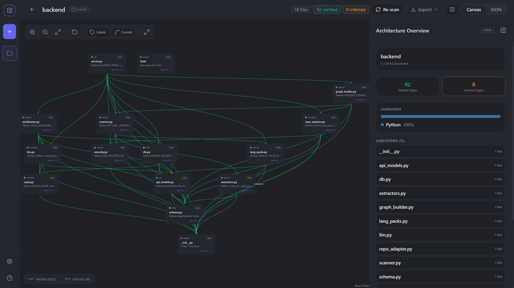
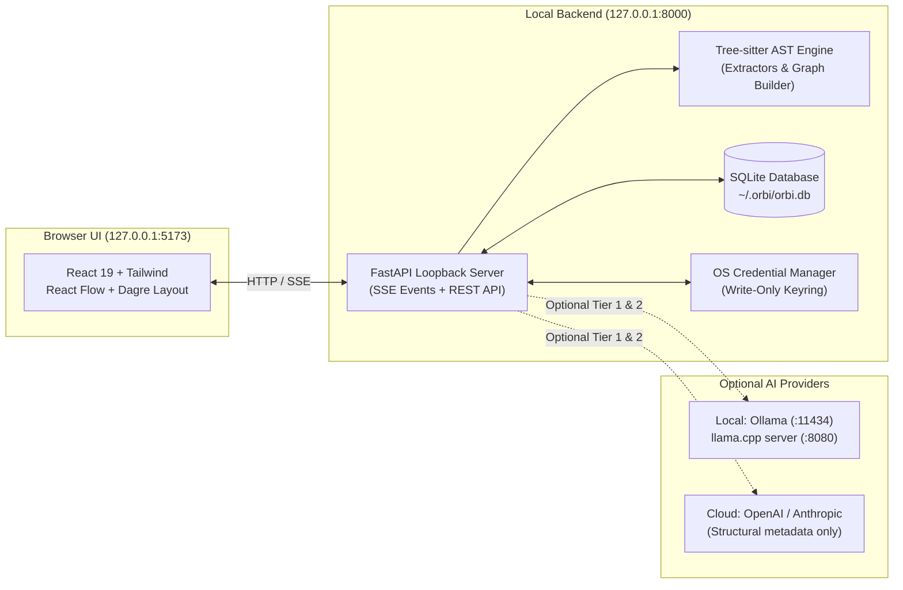
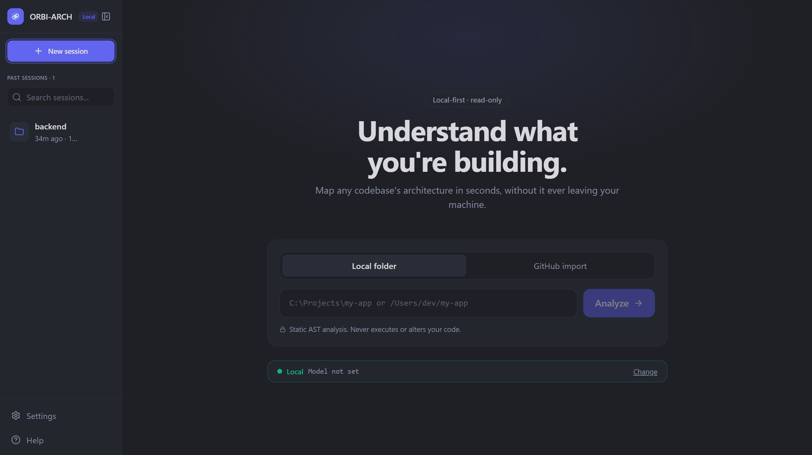
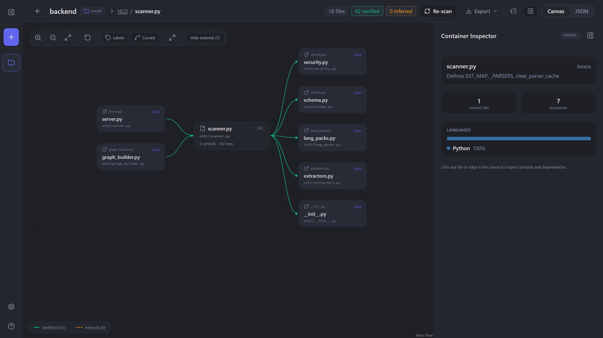
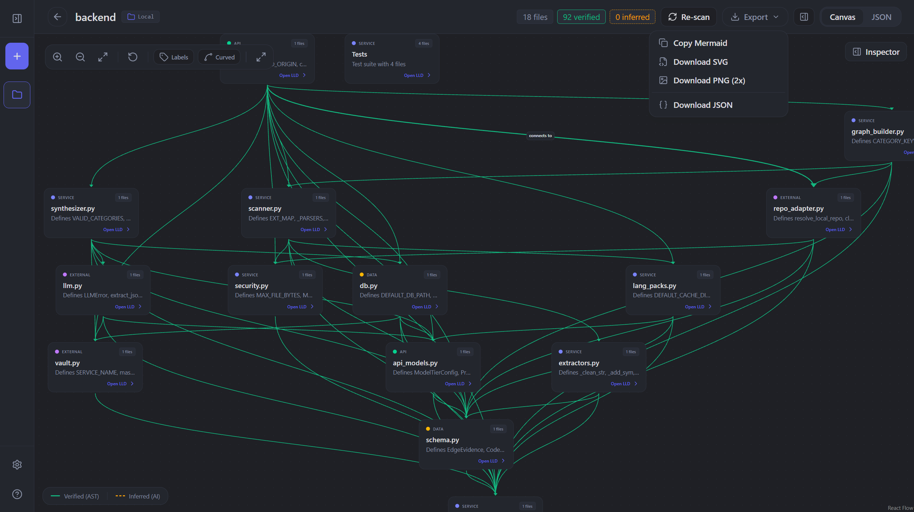

# ORBI-ARCH

> Local-first, zero-token deterministic architecture mapper & interactive HLD &rarr; LLD visualizer for local folders and GitHub repositories.

[](https://github.com/NOTE46/Orbi-Arch/actions/workflows/ci.yml)




---

## Key Features

- **0-Token Deterministic AST Engine**: Maps dependencies and subsystem boundaries locally with zero token consumption using Tree-sitter grammars. Verified edges cite exact source file and line numbers.
- **Interactive HLD &rarr; LLD Canvas**: Powered by React Flow and Dagre layout. Features neighbor focus dimming, custom subsystem renames, saved drag overrides, hideable Inspector panel (`I`), instant full-screen mode (`Shift+F`), curved/stepped/straight edge routing, and standalone `Tests` isolation.
- **On-Demand Language Packs**: Manage prebuilt offline grammars for **Python, TypeScript/JavaScript, C/C++, Java, Go, Rust, and C#** directly from Settings. No silent background downloads; secondary languages map gracefully with reminders.
- **Optional 2-Tier AI Synthesis**: Seamless integration with local models (**Ollama** `:11434`, **`llama.cpp` server** `:8080`) or cloud providers (OpenAI, Anthropic, Custom). Fast tier generates SHA-256 cached summaries; Strong tier synthesizes dashed amber **Inferred** edges without ever modifying verified AST edges.
- **One-Click Re-scan & Multi-Format Export**: Re-scan live repositories in-place while keeping dragged node positions and custom renames intact. Export architecture views as **Mermaid**, **SVG**, **2x PNG**, or schema **JSON**.
- **Privacy & Security by Default**: Strictly binds to `127.0.0.1` loopback. Write-only API key storage in your OS Credential Manager (`keyring`). Origin CSRF guard. Hard-blocks `.env`, credentials, private keys, `node_modules`, and symlink escapes.

---

## Architecture



---

## Quick Start

### Prerequisites
- Python 3.10+
- Node.js 20+
- Git

### Windows (One-Command Launcher)
Clone and launch with the convenience script:

```powershell
git clone https://github.com/NOTE46/Orbi-Arch.git
cd Orbi-Arch

# Create backend venv and install dependencies
python -m venv backend\.venv
.\backend\.venv\Scripts\pip install -r backend\requirements.txt

# Install frontend dependencies
cd frontend; npm ci; cd ..

# Launch both servers
.\start-orbi.ps1
```

Open `http://127.0.0.1:5173` in your browser (*note: use 127.0.0.1, not localhost, for loopback security*).

### Cross-Platform Manual Setup (Linux / macOS / Windows)

1. **Start the Backend:**
   ```bash
   cd backend
   python3 -m venv .venv
   source .venv/bin/activate  # On Windows: .venv\Scripts\activate
   pip install -r requirements.txt
   uvicorn orbi.server:app --host 127.0.0.1 --port 8000
   ```

2. **Start the Frontend:**
   ```bash
   cd frontend
   npm ci
   npm run dev
   ```

3. Navigate to `http://127.0.0.1:5173`.

---

## Screenshots Gallery

| Screen | Preview |
| :--- | :--- |
| **Launcher**<br/>Local folder / GitHub scanner with real-time health indicator |  |
| **Low-Level Design (LLD)**<br/>Detailed module drill-down with symbols & AST import links |  |
| **Export & Re-scan**<br/>One-click in-place re-scan and multi-format exports |  |

---

## Keyboard Shortcuts & Controls

| Key / Action | Function |
| :--- | :--- |
| <kbd>F</kbd> | Fit entire architecture graph to viewport |
| <kbd>Shift</kbd> + <kbd>F</kbd> | Toggle instant full-screen graph mode |
| <kbd>I</kbd> | Hide or reveal the right-hand Inspector panel |
| <kbd>Esc</kbd> | Clear selection &rarr; exit LLD drill-down &rarr; exit full-screen |
| **Double-Click** | Drill down into subsystem LLD or jump to an external module |
| **Drag** | Reposition any node (persisted across re-scans; reset via Toolbar) |

---

## Project Structure

```text
Orbi-Arch/
├── .github/workflows/ci.yml    # Parallel backend (Python 3.13) & frontend (Node 22) CI
├── backend/
│   ├── orbi/
│   │   ├── api_models.py       # Pydantic request/response/settings schema
│   │   ├── db.py               # SQLite storage (~/.orbi/orbi.db)
│   │   ├── extractors.py       # Multi-language Tree-sitter AST extractors
│   │   ├── graph_builder.py    # Subsystem grouping & dependency graph generator
│   │   ├── lang_packs.py       # Language Pack catalog & grammar cache manager
│   │   ├── llm.py              # LLM client (Ollama, llama.cpp, OpenAI, Anthropic)
│   │   ├── repo_adapter.py     # Local folder & GitHub Git repo reader
│   │   ├── scanner.py          # Multi-threaded repository AST scanner
│   │   ├── schema.py           # Core RenderSession & graph models
│   │   ├── security.py         # Path validation, secret blocking, Origin CSRF guard
│   │   ├── server.py           # FastAPI application & SSE progress streaming
│   │   ├── synthesizer.py      # Two-tier AI summarization & relationship synthesis
│   │   └── vault.py            # OS Credential Manager API key vault (keyring)
│   ├── tests/                  # Pytest test suite (17 tests)
│   ├── pyproject.toml          # Ruff linter & pytest configuration
│   └── requirements.txt        # Frozen backend dependencies
├── frontend/
│   ├── src/
│   │   ├── components/         # React components (Canvas, Inspector, Launcher, Settings)
│   │   ├── lib/                # Graph math, layout (Dagre), export (Mermaid/SVG/PNG), API client
│   │   └── types/              # TypeScript schema & UI interfaces
│   ├── package.json            # Frontend scripts & dependencies
│   └── vite.config.ts          # Vite build configuration
├── docs/screenshots/           # Documentation images
└── start-orbi.ps1              # Windows convenience launcher
```

---

## Performance & Bundle Budget

- **0-Token AST Parsing**: Instant deterministic scans with zero cloud LLM latency or cost.
- **Frontend Bundle Budget**: Main production bundle (`dist/assets/index-*.js`) is strictly capped at **$\le$ 105 KiB gzipped** (currently **98.97 KiB**).
- **Code Splitting**: Heavy views (`ArchitectureCanvas`, `SettingsView`, `HelpView`, `exportGraph`, `layout`) are lazy-loaded on demand.

---

## Development & Testing

Run the full local verification suite:

```bash
# 1. Backend Linting
python -m ruff check --config backend/pyproject.toml backend/orbi backend/tests

# 2. Backend Tests
cd backend && python -m pytest -v tests

# 3. Frontend Type Check
cd frontend && npx tsc --noEmit

# 4. Frontend Production Build & Bundle Gate
cd frontend && npm run build
```

---

## Security & Privacy Model

1. **Local-First Isolation**: Backend binds exclusively to `127.0.0.1:8000`. It is never exposed to external network interfaces.
2. **Write-Only Secrets**: API keys are saved directly into your OS Credential Manager (Windows Credential Manager / macOS Keychain / Secret Service) via `keyring`. Keys are never saved in SQLite or echoed to the browser.
3. **Hard-Blocked Sensitive Paths**: `.env`, `*.key`, `*.pem`, credential files, `node_modules`, `.git`, and symlink directory escapes are strictly skipped during scans.
4. **Zero Raw Code Sent to Cloud**: Optional AI tiers receive only structural metadata (file paths, symbol names, and import target names) &mdash; never raw file contents.

---

## License

This project is licensed under the [MIT License](LICENSE).
